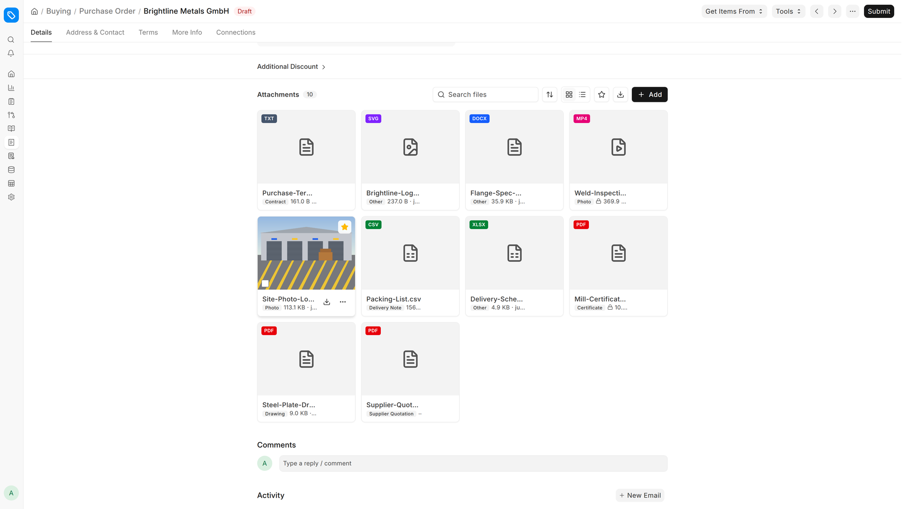
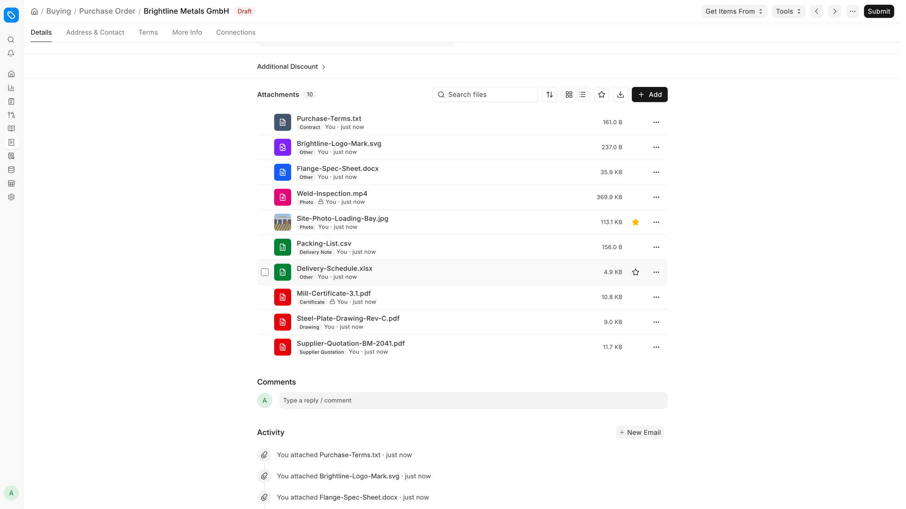
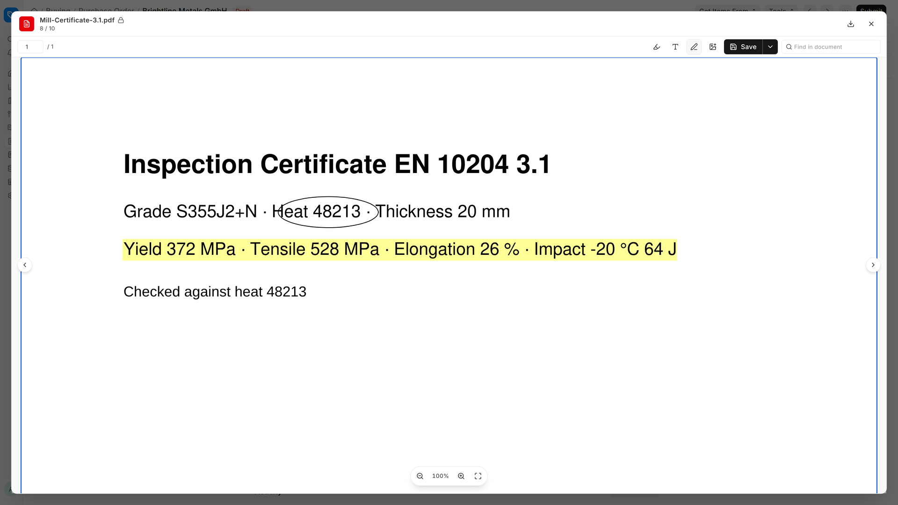
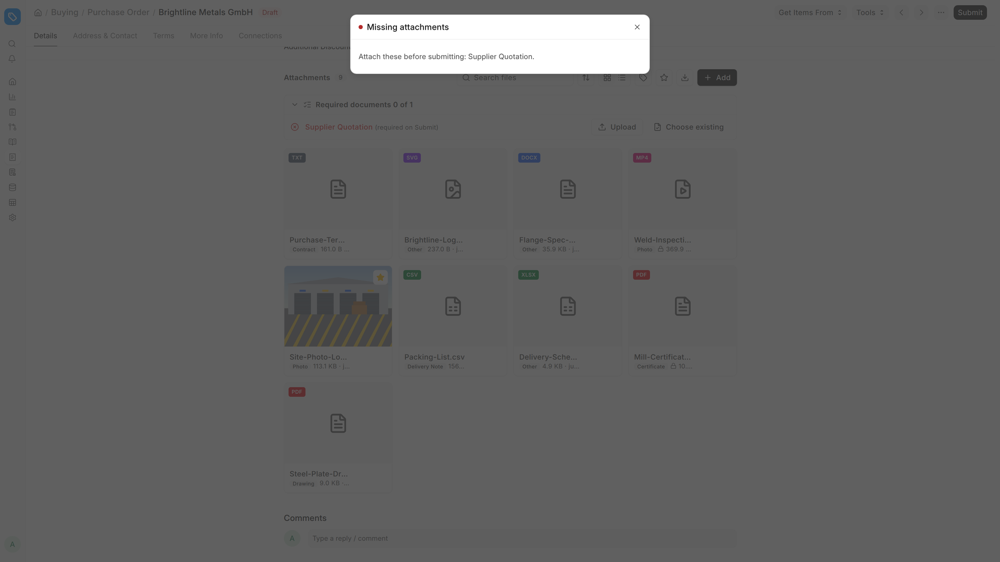
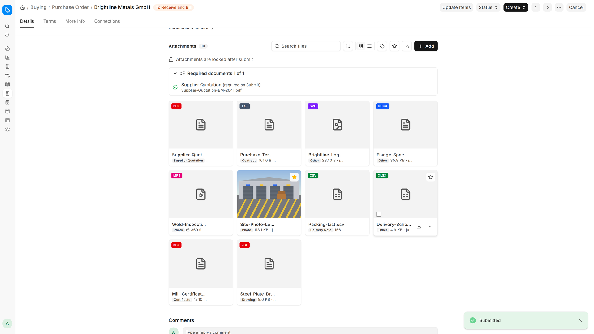
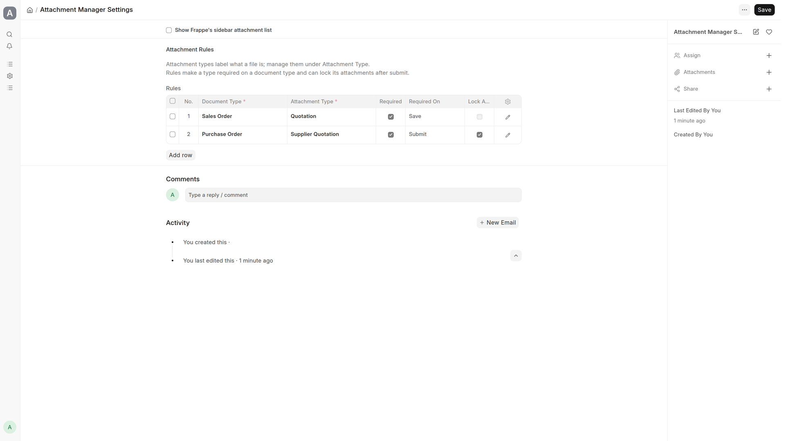

<div align="center">
	
	<h1>Attachment Manager</h1>
	<p>Every file on a Frappe form in one place: previewed in the form, typed, and required where it matters.</p>
</div>



▶ [Watch the 1-minute demo on YouTube](https://youtu.be/zb1PY-oLNs0)

Requires Frappe **v16** (`version-16`) or later. ERPNext is optional.

## Features

### Attachment panel
Replaces the form's attachment footer with a panel of every file on the document.

- Grid and list views, search, and sort by newest, oldest, name or size.
- A type chip on each file, and a filter by attachment type.
- One-click favourites, plus a filter to show only favourites.
- Upload with drag and drop, choose an existing file, or add a link with an optional label.
- Rename a file (its extension is kept), download it, make it private or public, or delete it.
- Select all shown files, then download them as a zip, change their privacy, set their type or delete them in one go.
- Users without write access can view and download, but not upload or change files.



### Preview inside the form
Click a file to open it without leaving the form. Use **← / →** to move between files and **Esc** to close.

- **Images:** zoom around the cursor with Ctrl + wheel or the zoom controls, then drag to pan.
- **PDF:** page navigation, zoom, fit, and find in document (Ctrl + F).
- **PDF annotations:** highlight, add text, draw, or add an image, then **Save** in place or **Save as copy**.
- **Office files and data:** DOCX, plus XLSX and CSV with sheet tabs.
- **Text and code:** read-only, with line numbers.
- **Audio, video and SVG:** played or shown in the preview.



### Attachment types and rules
- **Attachment Type** labels what a file is, for example Contract, Certificate, Drawing or Photo. A set of starting types is created on install.
- **Rules** in **Attachment Manager Settings** make a type required on a document type, on **Save** or on **Submit**.
- **Conditions:** a rule can carry a Python condition, written the way workflow transition conditions are, e.g. `doc.grand_total > 10000`.
- **Required documents checklist:** shown on the form, with **Upload** and **Choose existing** on each missing type. While a required type is missing, the document can't be saved or submitted (whichever the rule sets).
- **Lock after submit:** once the document is submitted, its attachments can't be renamed, retyped, made public or private, moved or deleted.

| Submit blocked until the required file is attached | Locked after submit |
|---|---|
|  |  |

## Installation
```bash
bench get-app attachment_manager https://github.com/Z4nzu/attachment_manager
bench --site <your-site> install-app attachment_manager
bench build
bench restart
```

## Configure rules
1. Open **Attachment Manager Settings**.
2. Add a row under **Rules**. For example: Document Type *Purchase Order*, Attachment Type *Supplier Quotation*, **Required**, Required On *Submit*, and **Lock After Submit**.
3. Optionally add a **Condition**, so the rule only applies to some documents.
4. Save. Purchase Orders now show the checklist, can't be submitted without a Supplier Quotation, and lock their files after submit.

Submit and lock rules only apply to submittable document types. Manage the list of types under **Attachment Type**.

The settings page also has **Show Frappe's sidebar attachment list**, which brings back Frappe's own attachment list in the form sidebar.



## Notes
- "Download all" uses Frappe's standard zip download, and only includes the files currently shown.
- If `onlyoffice_integration` is installed, documents get an **Open in OnlyOffice** action. Contact Hardik Zinzuvadiya for that module.

## Contributing
Set up on a Frappe v16 bench:
```bash
bench get-app attachment_manager https://github.com/Z4nzu/attachment_manager
bench --site <your-site> install-app attachment_manager
cd apps/attachment_manager
pre-commit install
```

pre-commit runs ruff (Python) and prettier + eslint (JS/JSX/CSS) on every commit, using Frappe's app conventions. Run it on everything with `pre-commit run --all-files`.

Before opening a PR:
```bash
bench --site <your-site> set-config allow_tests true
bench --site <your-site> run-tests --app attachment_manager
node --test tests/*.mjs
yarn build
```

## License
AGPL-3.0
